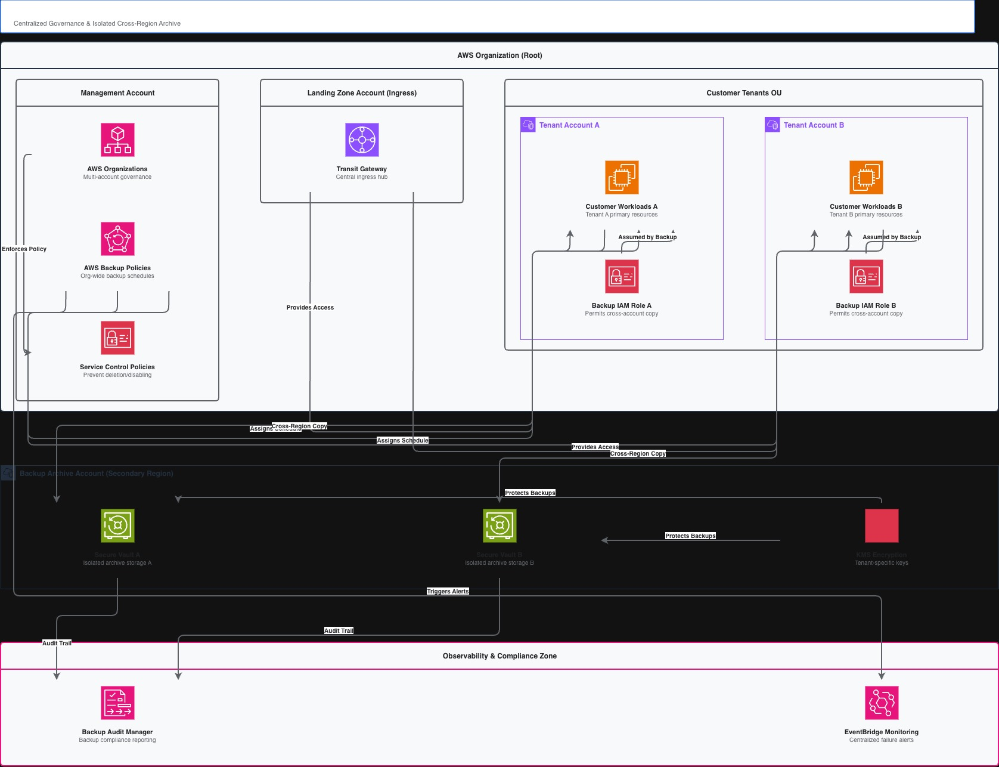
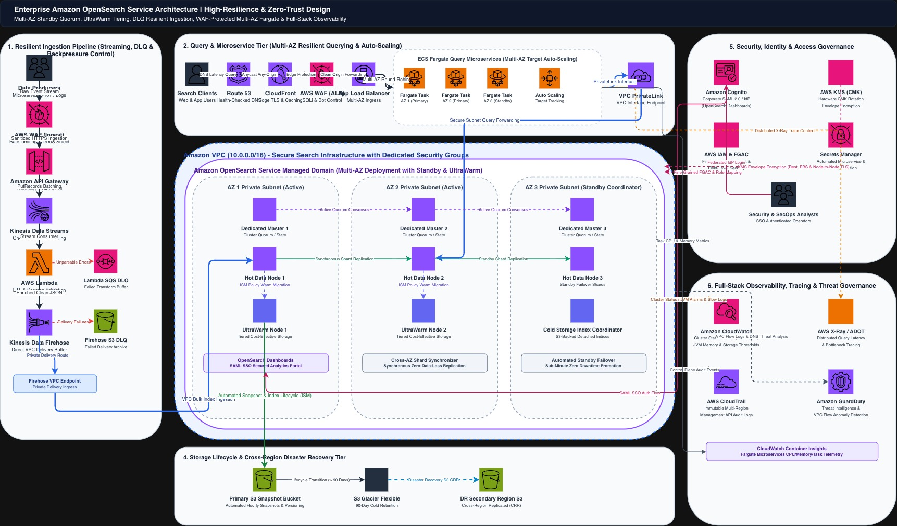
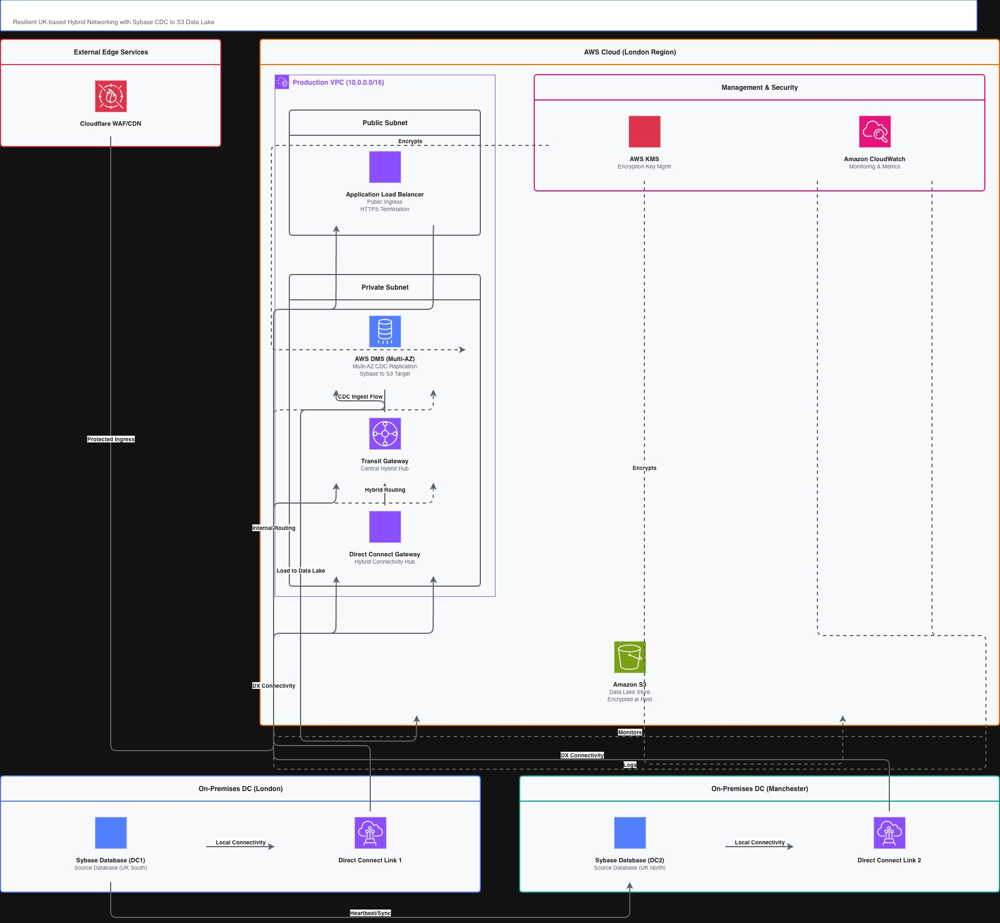
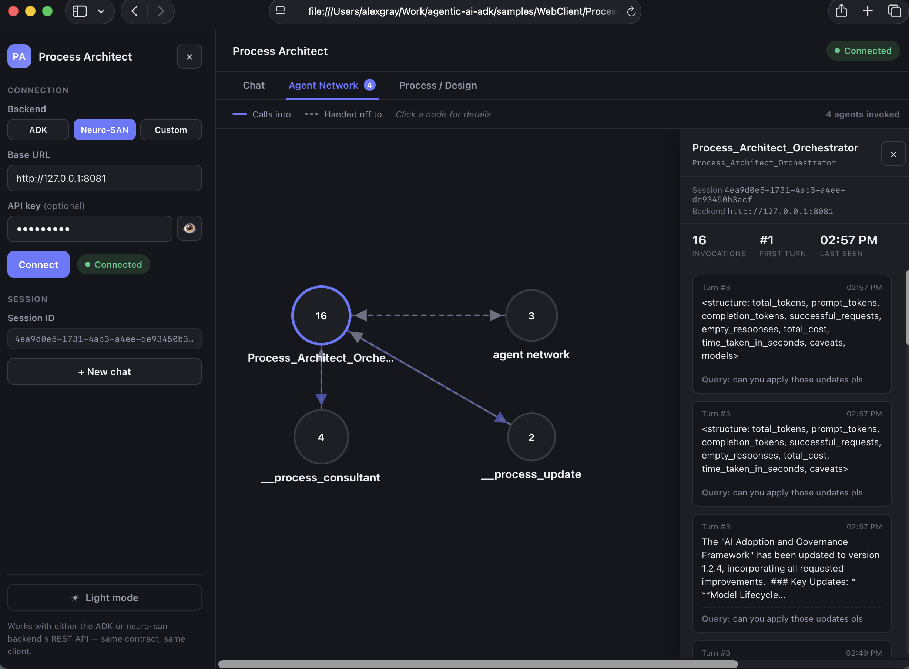
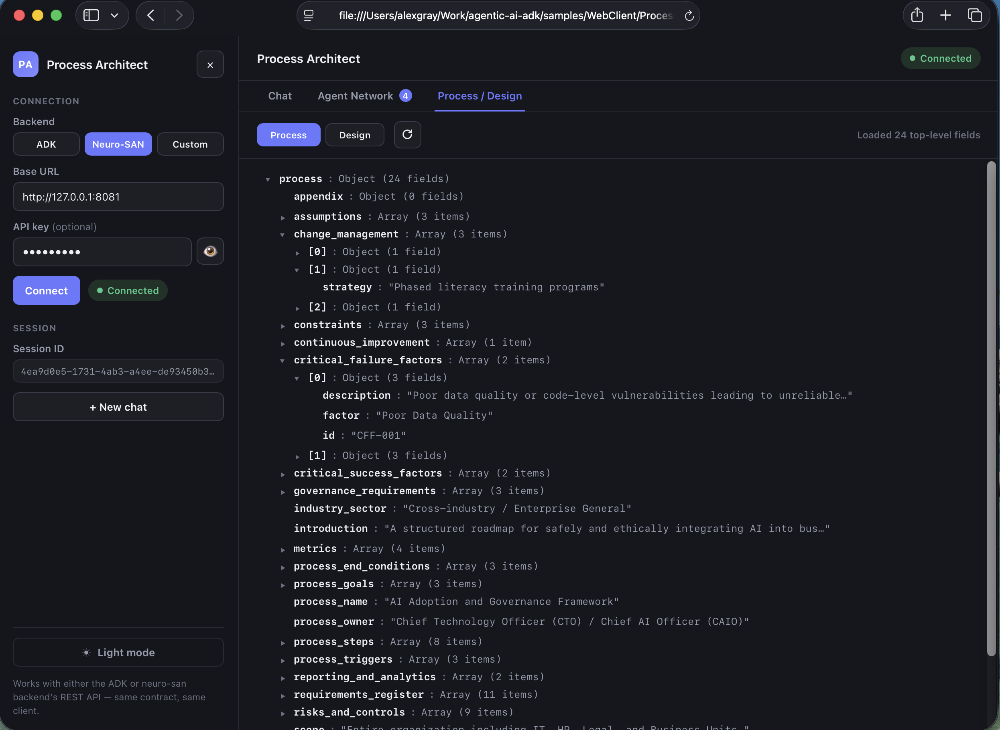
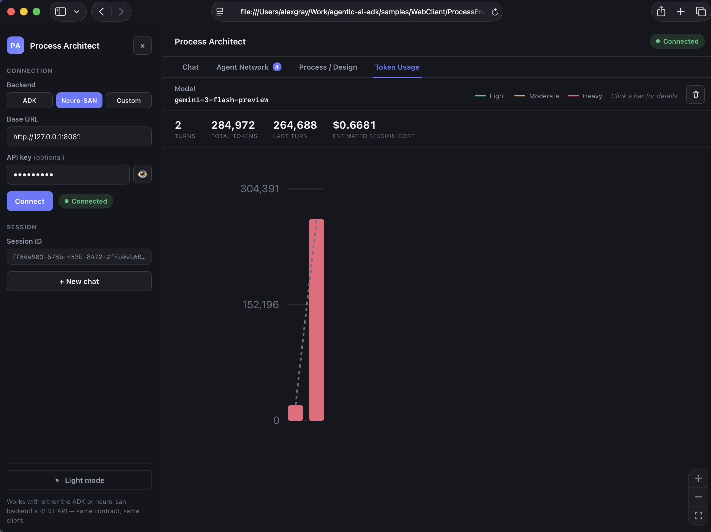
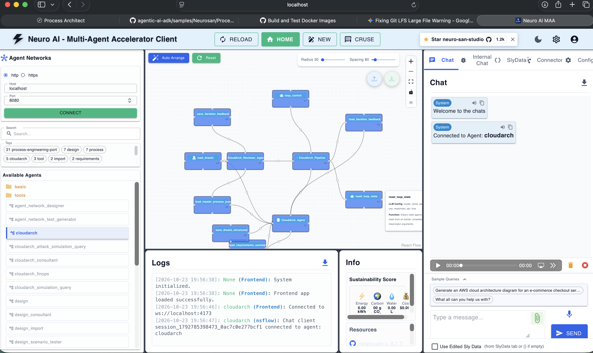

# Business Process Architect (neuro-san)

This multi-agent suite — built on [Cognizant's neuro-san](https://github.com/cognizant-ai-lab/neuro-san) framework — turns a rough, plain-language brief into a fully designed, tested, and documented business process, or a full architectural design document (HLD/LLD/Combined), complete with a professional, ISO-aligned Word document and diagrams. Built for architects, consultants, and engineering leads who need defensible, standards-aligned documentation fast, without hand-crafting it themselves.

Under the hood, a pipeline of specialized agents hands work off in sequence — one analyzes your requirements, one drafts the process or design, one audits it for compliance, one simulates it for bottlenecks or risks — looping back for revisions automatically until the output passes every check, then a final agent renders the Word document and diagrams.

This project was developed alongside [`samples/GCP/ProcessEngineering`](../../GCP/ProcessEngineering/README.md) and shares much of its core logic — document generation, diagram layout, and schema validation all come from a common `process_toolkit` package — so both produce the same output from the same schema. The real difference is the agent framework each one runs on: this version uses neuro-san's declarative agent networks, which means it can run against any LLM provider neuro-san supports (Gemini, Claude, OpenAI, Bedrock, Azure OpenAI, ...) — see [TECHNICAL_NOTES.md](TECHNICAL_NOTES.md) for how to configure that.

**Note - All examples provided are fictional and do not use any organizational's processes or information unless it is freely available.**

---

## ✨ What it does

- Turns a plain-language brief into a fully designed, reviewed, and documented **business process**.
- Does the same for **architecture design documents** (High-Level, Low-Level, or Combined design).
- Generates and refines **cloud architecture diagrams** (AWS/Azure/GCP) from a design document, including natural-language edits (e.g. "add a WAF in front of the load balancer").
- Answers questions, runs **"what-if" scenarios**, and **simulates** resilience/scalability/security/latency against an existing process, design, or diagram.
- Runs an **adversarial attack-path simulation** against a cloud architecture diagram, and estimates its **monthly cost** with optimization suggestions.
- **Imports** an already-existing process/design document from a folder of files, or **summarizes requirements** from a pile of documents before you've decided what to build.

---

## 🕸️ Agent Networks

This suite is built from a set of neuro-san agent networks — each one invocable directly (`--agent <name>`, or `ns chat <name>`) or routed to automatically by the top-level `process_architect` front-man. The table below covers all 21 (full detail is in [Agent inventory](TECHNICAL_NOTES.md#agent-inventory)):

| Network | What it is | What it does | Sub-agents it uses |
| :--- | :--- | :--- | :--- |
| `process_architect` | Top-level router (`Process_Architect_Orchestrator`) | Routes a request to whichever network below fits it. | Every network in this table |
| `process` | Creation pipeline (`Process_Pipeline`) | Analyzes requirements, designs, compliance-reviews, and simulates a new business process until it passes, then expands subprocesses and renders the final document. | `Analysis_Agent`, `Design_Agent`, `Compliance_Agent`, `Simulation_Agent`, `Subprocess_Driver_Agent`, `Subprocess_Generator_Agent` |
| `process_update` | Update pipeline (`Process_Update_Pipeline`) | Same generate/review loop, applied as a delta against an existing process. | `Process_Update_Analyst`, `Design_Agent`, `Compliance_Agent`, `Simulation_Agent`, `Subprocess_Driver_Agent`, `Subprocess_Generator_Agent` |
| `process_consultant` | Consultant (`Process_Consultant_Agent`) | Answers questions about an existing business process. | — |
| `process_scenario_tester` | Scenario tester (`Process_Scenario_Tester`) | Tests "what-if" scenarios against an existing process. | — |
| `process_simulation_query` | Simulation query (`Process_Simulation_Query_Agent`) | Runs a cycle-time simulation over an existing process and explains bottlenecks. | — |
| `process_import` | Import (`Process_Import_Agent`) | Imports an already-existing business process document directly into `process_data.json`. | — |
| `design` | Creation pipeline (`Design_Doc_Pipeline`) | Analyzes requirements, builds the HLD then elaborates the LLD (two separate stages), compliance-reviews, and simulates a new design document, then renders the final document. `Design_Doc_Agent` only applies review feedback on a revision pass -- it never builds from scratch. | `Design_Doc_Analysis_Agent`, `Design_Doc_HLD_Agent`, `Design_Doc_LLD_Agent`, `Design_Doc_Agent`, `Compliance_Agent`, `Simulation_Agent` |
| `design_update` | Update pipeline (`Design_Doc_Update_Pipeline`) | Same generate/review loop, applied as a delta against an existing design document. | `Design_Doc_Update_Analyst`, `Design_Doc_Agent`, `Compliance_Agent`, `Simulation_Agent` |
| `design_consultant` | Consultant (`Design_Consultant_Agent`) | Answers questions about an existing design document, with license to bring in outside best practice. | — |
| `design_scenario_tester` | Scenario tester (`Design_Scenario_Tester`) | Tests "what-if" scenarios against an existing design document. | — |
| `design_simulation_query` | Simulation query (`Design_Architecture_Simulation_Query_Agent`) | Runs the composite resilience/scalability/security/latency simulation over an existing design document. | — |
| `design_import` | Import (`Design_Import_Agent`) | Imports an already-existing design document (HLD/LLD/Combined) directly into `design_data.json`. | — |
| `cloudarch` | Creation/refinement pipeline (`CloudArch_Pipeline`) | Generates, refines, and reviews a cloud architecture diagram until it's approved; also applies natural-language edits to an existing one. | `CloudArch_Agent`, `CloudArch_Reviewer_Agent` |
| `cloudarch_consultant` | Consultant (`CloudArch_Consultant_Agent`) | Answers questions about an existing cloud architecture diagram. | — |
| `cloudarch_simulation_query` | Simulation query (`CloudArch_Simulation_Query_Agent`) | Runs a resilience/scalability/latency simulation over an existing diagram. | — |
| `cloudarch_attack_simulation_query` | Attack simulation (`CloudArch_Attack_Simulation_Query_Agent`) | Runs an adversarial attack-path simulation over an existing diagram. Analysis-only. | — |
| `cloudarch_finops` | Cost estimator (`CloudArch_FinOps_Agent`) | Estimates monthly cost and recommends optimizations for an existing diagram. | — |
| `requirements_summary` | Requirements summarizer (`Requirements_Summary_Agent`) | Reads a directory of files and saves a structured, traceable requirements summary. | — |
| `requirements_consultant` | Requirements consultant (`Requirements_Consultant_Agent`) | Answers questions about the saved requirements summary. | — |
| `regenerate_document` | Document regenerator (`Regenerate_Document_Agent`) | Regenerates only the diagram and final Word document from whatever is already on disk — no re-analysis, no review. | — |

---

## 📦 Outputs

Every run leaves behind a set of reusable artifacts in `output/`:

- A professional, ISO-aligned Word document (`.docx`) — the process or design document itself.
- Flow/architecture diagrams (level 1 and 2 process diagrams, or a cloud architecture diagram) as embedded images and, for cloud diagrams, editable drawio/mxGraph XML.
- The underlying structured data (`process_data.json` / `design_data.json`) — versionable, queryable, and reusable as input for later updates, scenarios, or simulations.
- A saved requirements summary (`requirements_summary.json`) when you use the standalone requirements-extraction feature.

---

## 🖼️ Sample Outputs

The following are a few real life outputs from the tool for Cloud architecture.

### Central Backup Solution


### Data Processing Solution


### Hybrid Cloud Solution


More examples — including business process documents and diagrams — are in [Sample Cloud Architecture Diagrams](TECHNICAL_NOTES.md#sample-cloud-architecture-diagrams).

### Browser Client

A few views from [`samples/WebClient/ProcessEngineering`](../../WebClient/ProcessEngineering/README.md), the browser chat UI that talks to either this or the ADK backend:

**Agent Network** — a live graph of which agents were invoked this turn; click any node for its own invocation history and per-call token/cost detail.


**Process / Design** — the generated process or design JSON, browsable as a collapsible tree.


**Token Usage** — per-turn token counts and estimated session cost.


---

## 🚀 Quick start

To quickly run the utility, you can do the following.

```bash
uv sync

export GOOGLE_API_KEY="<YourKey>"   # or ANTHROPIC_API_KEY, etc. -- see TECHNICAL_NOTES.md
uv run ns check-llm-keys            # confirm it's picked up correctly

uv run python cli.py
```

You'll get an interactive prompt:

```bash
[user]: create a simple 3-step vendor onboarding process
- Starting process pipeline. This will take some time...
[ArchitectBot]: Successfully generated a professional ISO-formatted Word document: output/Vendor_Onboarding.docx
[user]: exit
```

Prefer neuro-san's own chat UI? Then

`uv run ns run` 

starts it at `:4173`.  This will run the agent UI as shown
below



It can also run **detached as a REST API** using (`-d --flask`) or in **Docker** — see [Running as a Web Service](TECHNICAL_NOTES.md#running-as-a-web-service-rest-api) and [Docker Usage](TECHNICAL_NOTES.md#docker-usage) for more information. 

A ready-made browser chat UI that talks to either this or the ADK version is at [`samples/WebClient/ProcessEngineering`](../../WebClient/ProcessEngineering/README.md).

---

## 💬 Example prompts

- "Create an SDLC and release process for a WebDev application with microservices using an Agile Scrum base."
- "What roles are needed for a sprint planning session?"
- "What would happen if a security audit failed?"
- "Create a High-Level Design document for a payments microservices platform on AWS, including security architecture and scalability targets."
- "Generate a cloud architecture diagram for the current design document."
- "Run a simulation on the design to check for resilience, scalability, security, and latency issues."
- "Read the files in ./vendor-docs and create a process for onboarding new vendors."

Many more samples are documented in [Sample Prompts](TECHNICAL_NOTES.md#sample-prompts).

---

## 🧪 Status

**BETA.** Tested and generally stable, but LLM output can be unpredictable — always verify a generated process/design before relying on it. This sample is for demo purposes; NO WARRANTY OR GUARANTEE OF FUNCTIONALITY IS PROVIDED — see [LICENSE](https://github.com/tpayne/agentic-ai-adk/blob/main/LICENSE).

For the full feature list, repository layout, configuration options, complete REST API reference, compliance mappings, agent/network inventory, and known issues, see **[TECHNICAL_NOTES.md](TECHNICAL_NOTES.md)**.
